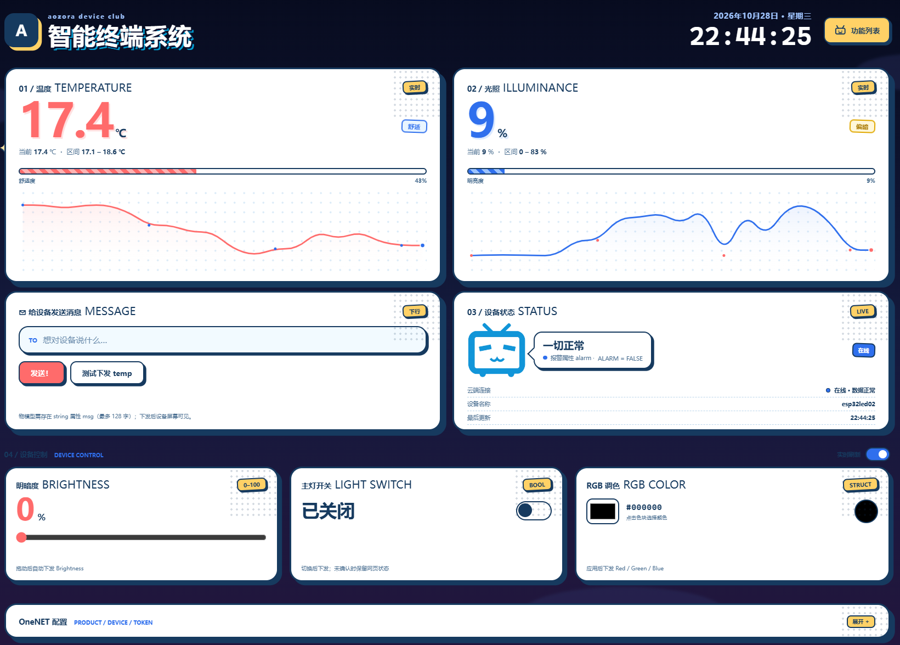
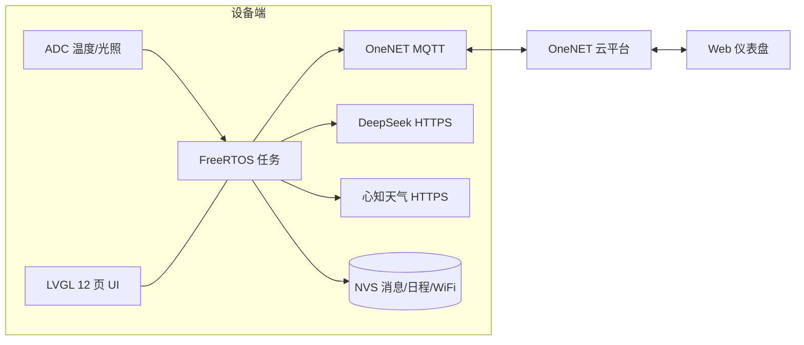

# ESP32-S3 智能终端

> 一块 320×240 的桌面小终端：环境监测、天气、消息、日程、AI 问答、2048、云端控制与 OTA，
> 全部跑在 ESP32-S3 上，界面是纯黑底 + 右侧弧形菜单的极简黑白风。


<h3 align="center">
  <a href="https://www.bilibili.com/video/BV1ecs96BEUN/">▶️ 观看 B 站演示视频</a>
</h3>

<p align="center">
  <sub>《菜鸟做的 ESP-S3 智能终端》· 1 分 18 秒 · 开机自检 → AP 配网 → 云端控制 → OTA 升级</sub>
</p>

---

## ✨ 项目简介

这是一个完整的 **ESP32-S3 桌面智能终端** 工程，不是单个 demo：它有开机自检页、12 个功能页、
移动端配网、OneNET 云平台接入、远程 OTA、网页仪表盘，以及一套按模块拆分的 FreeRTOS 任务结构。

项目重点在 **"能长期跑"**：心跳看门狗、任务隔离、NVS 持久化、A/B 双 OTA 分区。

| | |
|---|---|
| 主控 | ESP32-S3，240 MHz，16 MB Flash，8 MB OSPI PSRAM |
| 显示 | 320×240 ST7789（I80 8 位并口） |
| 触摸 | FT6336U（I2C 轮询） |
| UI | LVGL 9.x，黑白极简 + 右侧弧形滚动菜单 |
| 云平台 | OneNET（MQTT 物模型 + FOTA） |
| 大模型 | DeepSeek Chat API |
| 天气 | 心知天气（Seniverse）3 天预报 |
| 构建 | ESP-IDF v6.1 + CMake |

---

## 🧩 功能一览

| 模块 | 说明 |
|---|---|
| 🏠 首页 | 时钟、日期、温湿度/光照概览 |
| 🌡 环境监测 | 热敏电阻测温 + 光敏电阻测光照，2 s 采样，阈值告警 |
| ☁️ OneNET 云 | 属性上报 `temp` / `light` / `alarm`，2 s 一次；云端下发命令与消息 |
| 📲 远程控制 | 云端可开关灯（`LightSwitch`）、调亮度（`Brightness`）、调 RGB（`RGBColor`） |
| ⬆️ OTA | OneNET FOTA 远程升级，A/B 双分区，上报版本与升级进度 |
| 🌤 天气 | 心知天气 3 天预报，PNG 图标从 SPIFFS 读取（`image/` 分区） |
| 🤖 AI | DeepSeek 问答，独立任务 + HTTPS，不阻塞 LVGL 界面 |
| ✉️ 消息中心 | NVS 持久化、未读角标、消息来源标记（系统/云端/报警/日程） |
| 📅 日程闹钟 | NVS 存储，最多 8 条，到点提醒 |
| 🎮 游戏 | 2048，触摸滑动操作 |
| 📶 配网 | 长按按键开热点 `ESP32-AP`，网页配网；WiFi 账号存 NVS，开机优先读取 |
| 💡 灯光 | 3 颗 WS2812 + PWM 白光 LED，呼吸/报警效果 |
| 🐶 看门狗 | 心跳计数式软件看门狗，任务 15 s 无心跳自动重启 |
| 🌙 息屏 | 30 s 无操作自动息屏，触摸唤醒，背光走 XL9555 |
| 🖥 Web 仪表盘 | `web/` 下的单页网页：查看数据、开关灯、发消息、配置 OneNET |

---

## 🖼 界面

屏幕左侧是内容区，右侧是**常驻的弧形滚动菜单**，切页带淡入淡出/平移动画：

`首页` · `消息` · `设置` · `版本更新` · `日历` · `日程` · `天气` · `小智 AI` · `游戏` · `WiFi` · `云端` · `光照温度` · `息屏`

- 纯黑底 + 纯白字，无彩色图标（图标是 RGB565A8 位图）
- 所有坐标按屏幕尺寸动态计算，不写死分辨率
- 中文字体使用 LVGL 思源黑体 + 自制字库（`main/ui2/fonts/`）

---

## 📷 界面预览

### Web 仪表盘

`web/dashboard.html` —— 温度/光照实时曲线、云端消息下发、设备在线状态、灯光控制、OneNET 配置，手机和电脑都能打开。

<p align="center">
  
</p>

> 截图里的数据来自真实设备上报（温度 17.4 ℃、光照 9%）。

> 🎬 完整操作流程见 [B 站演示视频](https://www.bilibili.com/video/BV1ecs96BEUN/)（1 分 18 秒）。


## 🏗 软件架构



### 目录结构

```text
ESP32-S3-smart-terminal/
├── main/                   # 应用层
│   ├── app_secrets.h.example   # 密钥模板（真实密钥 app_secrets.h 不上传）
│   ├── board/              # 板级引脚定义
│   ├── init/               # 启动初始化：XL9555、按键、WiFi、SNTP
│   ├── port/               # LVGL 显示 + 触摸移植层
│   ├── ui2/                # 黑白 UI：页面、弧形菜单、字体、图标
│   ├── task/               # 任务：LVGL、开机、消息、日程、上报
│   ├── adc/                # 温度 / 光照采样
│   ├── iot/                # OneNET：token、MQTT、物模型、OTA
│   ├── weather/            # 心知天气
│   ├── ai/                 # DeepSeek 问答
│   ├── light/              # WS2812 + PWM LED
│   ├── voice/              # PDM 麦克风自检
│   ├── wdt/                # 心跳看门狗
│   ├── game/               # 2048
│   └── timesave/           # 时间断电保存
├── components/bsp/         # 板级驱动：ST7789、FT6336U、XL9555、AP 配网、WS2812
├── html/                   # 配网网页（烧进 html 分区）
├── image/                  # 天气图标（烧进 image 分区）
├── web/                    # PC/手机 Web 仪表盘
├── partitions.csv          # 16 MB Flash 分区表
├── sdkconfig.defaults      # 关键 Kconfig（16MB、Octal PSRAM、LVGL）
├── sdkconfig               # 本机完整配置（已提交，保证可复现）
└── README.md               # 本文件
```

### 启动流程

1. `init_all()`：XL9555 → 按键 → WiFi（优先 NVS 账号）→ SNTP 对时
2. `lv_port_init()`：LCD + 触摸 + LVGL，清屏后再开背光，避免开机闪屏
3. `lvgl_task_start()`：LVGL 主循环独立任务（8 KB 栈）
4. 创建 `living` / `begin` / `message` / `schedule` / `onenetpost` / `adc` 任务
5. 开机自检等待 WiFi / SNTP / OneNET / 版本四项就绪（最长 30 s），全绿后进首页

---

## 🚀 快速开始

### 1. 环境

- [ESP-IDF v6.1](https://docs.espressif.com/projects/esp-idf/en/latest/esp32s3/)（`dependencies.lock` 锁定 6.1.0）
- Python 3、Git
- 首次编译需要联网，组件管理器会自动下载 LVGL / cJSON / MQTT

### 2. 克隆并填密钥

```bash
git clone https://github.com/<你的用户名>/<仓库名>.git
cd <仓库名>
```

```powershell
# Windows
copy main\app_secrets.h.example main\app_secrets.h
```

```bash
# Linux / macOS
cp main/app_secrets.h.example main/app_secrets.h
```

然后编辑 `main/app_secrets.h`，填入自己的：

| 宏 | 用途 | 申请地址 |
|---|---|---|
| `DEEPSEEK_API_KEY` | AI 问答 | <https://platform.deepseek.com/> |
| `SENIVERSE_KEY` | 天气 | <https://www.seniverse.com/> |
| `ONENET_PRODUCT_ID` / `ONENET_ACCESS_KEY` / `ONENET_DEVICE_NAME` | OneNET 接入 | <https://open.iot.10086.cn/> |
| `WIFI_SSID` / `WIFI_PASSWORD` | 兜底 WiFi（NVS 没配网时才用） | — |

> `main/app_secrets.h` 已被 `.gitignore` 忽略，不会上传。仓库里只有 `.example` 模板。

### 3. 编译烧录

```bash
idf.py build
idf.py -p COM8 flash monitor
```

> 分区表和旧固件不同，**第一次烧录建议先 `idf.py erase-flash`**，再 `idf.py flash`。
> 如果换了 ESP-IDF 大版本，先 `idf.py set-target esp32s3`。

### 4. 配网

- **方式 A（推荐）**：长按板载按键 → 设备开热点 `ESP32-AP`（密码 `12345678`）→
  手机连接后浏览器打开 `http://192.168.100.1` → 扫描/选择 WiFi 并输入密码。
- **方式 B**：在屏幕 `WiFi` 页扫描并选择热点。
- 配网成功后账号写入 NVS，下次开机优先使用；也可在 `app_secrets.h` 里配兜底账号。

### 5. 云端

在 OneNET 控制台创建产品与设备，物模型标识符需要与代码一致：

| 标识符 | 类型 | 方向 | 说明 |
|---|---|---|---|
| `temp` | float | 上报 | 温度 ℃ |
| `light` | int | 上报 | 光照 % |
| `alarm` | bool | 上报 | 温度告警状态 |
| `msg` | string | 下发 | 显示到设备屏幕的消息 |
| `LightSwitch` | bool | 下发 | 开关灯 |
| `Brightness` | int | 下发 | 亮度 0~100 |
| `RGBColor` | struct | 下发 | RGB 调色（Red/Green/Blue） |

### 6. Web 仪表盘

```bash
cd web
python server.py
# 浏览器打开 http://localhost:8080/dashboard.html
```

- Windows 也可以直接双击 `web/双击启动网页.bat`
- 想放到公网：把 `web/index.html` 和 `web/_redirects` 拖到 Netlify Drop（见 `web/如何上线到公网.txt`）
- 网页默认配置为空，首次打开在「OneNET 配置」里填产品 ID / 设备名 / Token（Token 可用 `web/gen_token.py` 生成）

---

## 💾 分区表（16 MB）

| 分区 | 类型 | 偏移 | 大小 | 用途 |
|---|---|---|---|---|
| `nvs` | data/nvs | 0x9000 | 24 KB | WiFi、消息、日程 |
| `otadata` | data/ota | 0xf000 | 8 KB | OTA 状态 |
| `phy_init` | data/phy | 0x11000 | 4 KB | RF 校准 |
| `html` | data/spiffs | 0x20000 | 1 MB | 配网网页 |
| `image` | data/spiffs | 0x120000 | 1 MB | 天气图标 |
| `factory` | app | 0x220000 | 3 MB | 出厂固件 |
| `ota_0` | app | 0x520000 | 3 MB | OTA 槽 A |
| `ota_1` | app | 0x820000 | 3 MB | OTA 槽 B |
| `model` | data/spiffs | 0xb20000 | 2 MB | 语音模型预留 |

> ⚠️ 改分区表后必须 `idf.py erase-flash`，否则启动异常。

---

## 🧪 已实现 

**已完成**：LVGL 12 页 UI、WiFi 配网与 NVS、OneNET 上下行、DeepSeek 问答、天气、
消息中心、日程、2048、WS2812/LED、心跳看门狗、息屏、Web 仪表盘、OneNET OTA。

## 🙏 致谢

- [ESP-IDF](https://github.com/espressif/esp-idf) / [LVGL](https://lvgl.io/)
- [OneNET](https://open.iot.10086.cn/) 物联网平台
- [心知天气](https://www.seniverse.com/)、[DeepSeek](https://www.deepseek.com/)

> 本项目未附带 LICENSE 文件，默认保留所有权利；如需开源请自行补充许可证。
> 代码与文档主要用于学习交流，接入第三方服务请遵守其服务条款。
